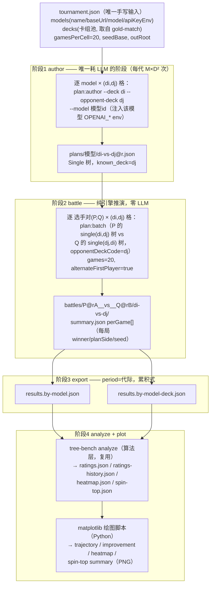

# 跨模型卡组锦标赛与排位分体系（cross-model rating tournament）：设计定稿

> 日期：2026-09-03。状态：**设计定稿**（待实现）。
> 决策过程：tree-bench 对接缺口分析 → 赛制设计（镜像/交叉/正反手）→ 跨代轨迹 →
> 图表调整，2026-09-02/03 会话拍板。
> **执行修订（2026-09-05）**：卡组池（4 环境分离版本钉扎 × 各 8 套）/每格局数（15 局）/
> R9 证据源（own-generations，含跨模型局）/赛程锚点矩阵（拍板不做，锚点实验改为
> 起草侧 `--anchor` 复验）/M（provisional 4）/R（跑到饱和）按当日
> 用户拍板修订，以 [2026-09-05-tournament-execution-plan.md](./2026-09-05-tournament-execution-plan.md) 为准。
> 关联：`2026-09-02-two-layer-portfolio.md`（决策树在 oracle-free harness 中按代迭代）；
> `packages/benchmark/tree-bench/`（Glicko-2 / heatmap / spinning-top 分析引擎，算法层复用）。

## 1. 目标

多个 LLM（qwen-3.8-max/plus/flash、deepseek-v4-pro/flash、glm-5.3/flash、hy3/hy4 等，
各模型厂商官方平台调取API，Openrouter单次输出有时限无法完成本任务）在**指定卡组池**上互相对战，产出：

1. 当代 Glicko-2 排位榜（模型总榜 + 模型×卡组分榜）；
2. **跨代排位分变化轨迹**（决策树随 oracle-free harness 逐轮 reflect 迭代，每轮产物
   作为一代选手进池，回答"哪个模型的迭代涨分快/稳"）；
3. 克制关系热图与 spinning-top 结构诊断（复用 tree-bench）。

关键认知：**对战阶段零 LLM 调用**——决策树赛前生成，`plan:batch` 为确定性引擎推演，
成本集中在 author/reflect；几千局对战为分钟级。

## 2. 决策定稿（R1-R9）

| # | 决策项 | 定稿 | 理由 |
|---|--------|------|------|
| R1 | 选手身份 | **模型（树），非卡组**；deck 是对局条件 | tree-bench 禁止 p1===p2；镜像同 deck 对局中 A/B 仍是两名选手 |
| R2 | 对战单位 | **Single 逐格树**：每 `模型×本方卡组×对手卡组` 一棵（`--deck di --opponent-deck dj` 起草，`known_deck`） | 单树两侧都能坐 → 绕开 side-1 portfolio 缺口；明牌表赛制下双方赛前均知对手，信息对称；`assertOpponentAlignment` 重新生效（拿错树 fail-fast） |
| R3 | 赛程 | **卡组指派全矩阵 D²**：对角镜像批 + 非对角双向交叉批（主客场制） | 双向都打 → 牌差在模型对上抵消；每模型带每卡组局数严格相同 → 总榜 deck-公平 |
| R4 | 每格局数 | **每格 15 局，格 = (本方卡组,对手卡组,先手方)**（2026-09-05 修订，原 20 局正反手各 10）：每 (di,dj) 一批 30 局，`alternateFirstPlayer: true` 正反手各 15 | 消除先手偏差；引擎先手固定玩家 0，交替机制现成 |
| R5 | 跨代机制 | **每代 = 独立新选手**（`model@r`），池跨代累积，`period` = 代际号 | Glicko-2 是池内相对值；不跨代则每代是孤立锦标赛，分数跨代不可比 |
| R6 | 必要对边 | 同代跨模型全互打 + **同模型跨代链**（X@r vs X@(r-1)）；跨模型跨代可选；r0 锚点矩阵 **2026-09-05 拍板不做**（树进步快，对 r0 对局信息量随代快速衰减） | 连通性论证：同代全互打（代内连通）+ 同模型链（相邻代连通）⇒ 全图连通同一把尺；同模型跨代胜率 = reflect 净增益直接可读 |
| R7 | 图表渲染 | **matplotlib**（Python）；tree-bench 只产出数据 JSON，渲染移交绘图脚本 | 取代 tree-bench 手写 SVG 的新图计划；tree-bench 保留计算与 JSON 输出，`heatmap.svg` 降级为 legacy |
| R8 | 导出视角 | 双视角 results.json：`by-model`（p1=模型）/ `by-model-deck`（p1=模型@卡组）+ `mirror-only` 过滤器 | 同一批对局、两套命名、两次 analyze，零额外对局成本 |
| R9 | 跨代树来源 | **harness `--patch` 模式**（2026-09-05 拍板）：每 模型×本方卡组 一个 portfolio（共 M×ΣD_e 个）；r0 = `plan:author` 逐格起草，r ≥ 1 = `plan:reflect --portfolio --patch` 逐代修订，锦标赛每代从各 portfolio 产物按 (di,dj) 格取 single 树进池。**证据 = 自身历代树的对战记录（own-generations 口径，已拍板）：该模型当代树参与的上一轮全部对局（链批 + 跨模型批，双向侧均含）** | 原管线只有 author 阶段，"跨代轨迹 / reflect 净增益"无来源；own-generations 使反思含真实对抗性失败样本；代价：跨模型榜部分 in-sample（共同演化记录），论文须声明 |

**不做的事**：不为起草随机性做 k 次起草/选优——决策树在 oracle-free harness 中持续迭代，
起草方差由迭代过程吸收（拍板）；General-vs-Single 混合赛制不做（两侧树类型必须一致，
否则信息不对称）。

## 3. 管线总览



## 4. 赛程设计

### 4.1 卡组指派矩阵（D=3 示例，对一对模型/选手对）

| 本方带 \ 对方带 | d1 | d2 | d3 |
|---|---|---|---|
| **d1** | 镜像批 | 交叉批 | 交叉批 |
| **d2** | 交叉批 | 镜像批 | 交叉批 |
| **d3** | 交叉批 | 交叉批 | 镜像批 |

- 对角 = 镜像（双方同 deck，牌差=0，纯树力信号）；
- 非对角 = 交叉，**双向都打**（(d1,d2) 与 (d2,d1) 各一批）：卡组 i 克 j 的牌差两个方向
  各出现一次，聚合到选手对上互相抵消；
- 交叉格 `P@di vs Q@dj` 的配置：`plan` = P 的 `single(di,dj)`，`opponent.plan` =
  Q 的 `single(dj,di)`，`opponentDeckCode = dj`；两侧 known_deck 声明与实际牌表一致，
  alignment 断言通过。

### 4.2 每代赛程（r ≥ 1）

| 批次 | 规模 | 作用 |
|---|---|---|
| 同代跨模型矩阵 | C(M,2) × D² 批 | 当代主榜信号 |
| 同模型跨代矩阵 | M × D² 批 | 改善信号（reflect 净增益）+ 图连通 |
| ~~（可选）r0 锚点矩阵~~ | — | **2026-09-05 拍板移除**：树进步快，对 r0 对局信息量随代快速衰减 |
| （可选）跨模型跨代 | 抽样 | 仅要更壮估计时加 |

**成本**（2026-09-05 修订：E=5 环境 × 每环境 D_e=8、M=4、每格 15 局即每 (di,dj) 30 局）：
每代同代跨模型 C(4,2)×5×64×30 = **57,600 局** + 同模型链 4×5×64×30 = **38,400 局**
（两者均为 R9 证据组成），合计 **96,000 局**引擎推演；author 仅 r0 一次性 M×E×D² = 1280 次，
reflect 每代 M×ΣD_e = 160 次。选手池每代 +M。执行方案 §7 按冒烟实测吞吐回填墙钟时间。

**每代树来源（R9 细化，2026-09-05 修订）**：r0 为 author（M×ΣD_e² 棵）；r ≥ 1 复用
已实现 harness——`model-tournament.ts` 的 `evolve` 编排逐 portfolio（M×ΣD_e 个）：
**证据 = 该模型当代树参与的上一轮全部对局（own-generations 口径：链批 X@(r-1) vs
X@(r-2) + 跨模型批 X@(r-1) vs Y@(r-1)，双向侧均含）**，经证据目录适配器组装为
reflect `--run-dir` 可读组 → `plan:reflect --portfolio --patch` → 产出当代树。
方法论代价：跨模型榜部分 in-sample（共同演化记录），论文须声明。
LLM 成本口径：author 调用仅 r0 发生；r ≥ 1 每代为 M×ΣD_e 次
reflect 调用（harness 模式有界多轮）。

### 4.3 单格样本量口径

每格 15 局（格 = (di,dj,先手方)），胜率标准误 ~±13pp → **per-cell 读数仅作诊断**；
模型级总榜聚合每选手对 E×D²×30 局（E=5、D=8 时每对 9,600 局，SE ~0.5pp）为主读数。
同模型跨代对是效应量最小、最关心的比较，证据即链批（每代 30,720 局）样本量充足；
绝对改善读数不采（r0 锚点矩阵已拍板移除，§4.2），轨迹只作链式相对比较
（见执行方案 §8-4）。

## 5. 偏差消除分析

| 固有偏差 | 消除机制 | 状态 |
|---|---|---|
| 先手偏差 | 正反手各 15 局（每格 15 局，格 = (di,dj,先手方)；alternateFirstPlayer） | ✅ 消除 |
| 卡组牌差 | 指派矩阵双向 + 每模型带每卡组局数相同 | ✅ 聚合层面消除 |
| 信息不对称 | Single 逐格起草，双方均知对手牌表（与引擎明牌表赛制一致） | ✅ 对称 |
| 对手侧组合链不可用 | Single 单树两侧可坐 | ✅ 绕开 |
| 配对错位 | known_deck 声明 + assertOpponentAlignment fail-fast | ✅ 附赠校验 |
| 起草随机性 | oracle-free harness 持续迭代吸收 | ✅ 拍板不做 k 次起草 |
| 样本噪声（残余） | per-cell ±13pp；以模型级聚合为主读数 + bootstrap 区间 | ⚠️ 读数纪律约束 |
| 平局 | 引擎 perGame `winner: 0\|1\|null`（null=平局）；export 层须映射 null→"draw"、0→"p1"、1→"p2"——tree-bench 归一化（`results.ts` `parseGameResult`）对 null 直接 fail-fast 拒收；映射后 draw 计 0.5，两侧语义一致 | ✅（映射契约已并入 §8.1 export 规格） |
| 镜像自对局 p1===p2 | 选手身份=模型，同 deck 互打身份不同；同模型**同代**对局不排入赛程 | ✅ |

## 6. 评分、period 与跨代轨迹

- **身份与池**：选手 = `model@r`（总榜）/ `model@deck@r`（卡组级）；每代 +M 进池，
  历史 **累积 results.json**（含全部代际），`period` = 代际号 r，同代全部对局为一个
  Glicko-2 rating period（期内期初快照语义，见 `tree-bench/src/glicko2.ts` 文档注释）。
- **歇战选手**：`applyRatingPeriod` 对期内无对局选手走空更新路径
  （`glicko2.ts:91-96`、`225-229`）——仅 RD 膨胀、分数冻结。已验证，无需改动。
- **轨迹提取**：`analyze` 内部本就逐 period 循环，新增**每期结束后 µ/φ/σ 落盘
  `ratings-history.json`**（取代早先"逐代重跑快照"的临时方案）。轨迹 = 该文件直接绘图。

## 7. 分析图表（matplotlib，R7 定稿）

### 7.1 架构与约定

```
tree-bench analyze（TS，算法层）
  → out/ratings.json / ratings-history.json / heatmap.json / spin-top.json / results.json
plots/plot_*.py（Python + matplotlib）
  → out/plots/*.png（300dpi）
```

- 脚本位置：`packages/benchmark/tree-bench/plots/`；依赖仅 `matplotlib`（requirements.txt）；
- 产物统一 `out/plots/`，PNG 300dpi（报告嵌入），可选同名单独 SVG；
- **图表内文字用英文**（模型名本为 ASCII；避免 matplotlib 中文字体配置问题；
  若确需中文标题，运行时注册 Noto Sans CJK / SimHei 并设置 `axes.unicode_minus=False`）；
- 置信带一律画（±2φ 或 bootstrap 区间），防止对点估计过度解读。

### 7.2 图清单

| 图 | 文件 | 输入 | 内容与要点 |
|---|---|---|---|
| 排位轨迹（head 图） | `trajectory.png` | `ratings-history.json` | 横轴代际，每模型一条 µ 曲线 + ±2φ 置信带；新代进池点标注 |
| 迭代增益 | `improvement.png` | `ratings-history.json` / results.json 过滤 | 每模型 X@r vs X@(r-1) 聚合胜率 ±CI 折线/柱状；50% 基准线 |
| 全史胜率热图 | `heatmap-full.png` | `heatmap.json`（by-model） | 行列按 模型×代际 分组排序呈块结构；**无对局格独立视觉态**（灰底/hatch），每格标注 n；尺寸自适应（>40 选手时缩字号/去标签） |
| 最新代卡组热图 | `heatmap-deck-latest.png` | `heatmap.json`（by-model-deck，仅当代） | 模型×卡组 级克制关系；历史版本按 `--rounds` 过滤不画全史 |
| 结构诊断摘要 | `spintop-summary.png` | `spin-top.json` | 传递/循环占比条形 + Nash averaging 条形 + 各团块成员表 |

### 7.3 数据量增长后的调整（已纳入图清单设计）

1. **热图**：无对局格不得按 0.5 呈现（现 `results.ts:158` 计算层填 0.5 供算法使用，
   **呈现层必须区分"未交手"与"交手且五五开"**），并前置 coverage 统计
   （实交手对数/总对数）；
2. **spinning-top**：稀疏池下分解只对**稠密子锦标赛**做（当代全体 + 同模型链，
   或 ≥k 局选手对），循环结构结论仅在稠密子块内下；
3. 全史热图只出 by-model；卡组级只出最新代——否则 90×90 网格不可读；
4. bootstrap 重采样成本可忽略（纯 TS，几万局 × 200 次为秒级），无需调整。

## 8. 实现清单

### 8.1 新建

| 件 | 位置 | 内容 |
|---|---|---|
| `tournament.json` schema + 解析 | `packages/gi-agent/scripts/ops/` | models/environments(含 gameVersion+decks)/gamesPerCell/seedBase/outRoot/evidenceScope(own-generations)/rounds/gameArchive |
| 编排脚本 `model-tournament.ts` | 同上 | 子命令 `author`（r0：M×D² 逐格起草，逐模型 env 注入，失败隔离）/ `battle`（选手对×格矩阵枚举，幂等续跑，seed 按 (pair,di,dj,round) 确定性派生）/ `export`（summary→results，双视角+mirror-only，period=round；winner 语义映射：引擎 perGame `0\|1\|null` → tree-bench `"p1"\|"p2"\|"draw"`，null=平局按 draw 计 0.5，否则 `results.ts` 归一化 fail-fast）/ `analyze`（调 analyze + 调 matplotlib） |
| `ratings-history.json` 导出 | `tree-bench/src/cli/analyze.ts` | 逐 period 循环内落每期 µ/φ/σ（小改） |
| matplotlib 绘图脚本 | `tree-bench/plots/plot_*.py` | §7.2 五张图；requirements.txt（matplotlib） |
| spin-top 子锦标赛过滤 + coverage | `tree-bench/src/cli/analyze.ts` / `spin-top.ts` | 稠密子块参数 + 报告前置 coverage 统计 |

**契约对齐（整合稿重叠 4，2026-09-05 拍板；执行方案 §5 契约）**：`model-tournament.ts`
与 `batch-runner.ts` 实现同一 P0-5 run 目录契约——battle 产物写分区字段 + 分级归档
（`gameArchive`：链批局 + 跨模型局 game-\* 目录 keep（R9 own-generations 证据需要
trace/summary；organizer 取证用链批局）、state log 抽样率可配）。`evolve` 子命令承担
R9 的证据组装（own-generations 口径）→ reflect 编排。

### 8.2 复用（零改动）

`plan:author`（`--deck/--opponent-deck/--model/--game-version` 全部现成）、`plan:batch`
（`opponent.type="plan"` + `alternateFirstPlayer` + `config.gameVersion` 版本钉扎现成）、
`runPlanBatch` perGame 落盘、`plan:reflect --portfolio --patch`（singles 分层修订，
`reflect-portfolio.ts`）与 `scripts/ops/portfolio-generation.ts` 编排先例（R9 跨代树来源）、
Glicko-2 / results / heatmap / spin-top 算法层、卡组池 `tree-bench/summoners-decks/`
（版本分档热门卡组，2026-09-05 起取代 gold-match deck-list 为锦标赛池源）。

## 9. 已知限制与读数纪律

1. per-cell（15 局）读数只作诊断；排名结论以 by-model 聚合 + bootstrap 区间为准；
2. 传递占比低或区间宽时，只信 spire 排序，循环团块内部不可排序（tree-bench README 口径）；
3. 全史卡组级热图不做（尺寸不可读）；轨迹看 by-model；
4. 同模型跨代链的测量噪声随代累积；绝对改善读数不采（r0 锚点矩阵 2026-09-05 拍板不做
   ——树进步快、信息量随代快速衰减），轨迹只作链式相对比较；
5. 选手池随代线性增长，R>5 后 spin-top/热图必须走子锦标赛过滤；
6. **安全**：`tree-bench/API.txt` 内含明文 API key，与本项目功能无关，需作废并移出仓库。

## 10. 开放参数（实现前拍板）

| 参数 | 说明 | 2026-09-05 状态 |
|---|---|---|
| 卡组池 | **已拍板框架**：5 环境各 8 套热门（对局分开、版本各自钉扎），源 `tree-bench/summoners-decks/{v}.json` top-8（usageRate 降序）；之后可能缩减 | 5 档全用（4.0/4.8/5.3/5.8/6.3），与影幻杯/枫达杯 5 届的映射待确认；执行方案 §3 |
| M | 首批模型清单 | provisional 4（API.txt 现有凭据：deepseek-v4-pro-0813 / deepseek-v4-flash-vision-exp / glm-5.3 / glm-5.3-flash；qwen、hy 待补凭据）；用户保留改动权；执行方案 §9-1 |
| G（每格局数） | 正反手视作不同格 | **已拍板 15/格**（每 (di,dj) 30 局） |
| R（迭代代数） | harness reflect 轮数 | **跑到饱和**：先验 ~9 代、上限 12；**论文 R = 4 模型小型赛实测停点** |
| 证据口径（R9） | evolve 反思证据源 | **已拍板 own-generations**（自身历代树参与的全部对局，含跨模型；论文须声明部分 in-sample） |
| r0 锚点（赛程） | 是否每代加打起点 | **已拍板不做**（树进步快、信息量随代快速衰减）；"锚点"另指起草侧 `--anchor` 两阶段策略分析，其复验独立排（执行方案阶段 3） |
| Python 环境 | venv / uv + matplotlib 版本 | uv，matplotlib ≥3.8 |
