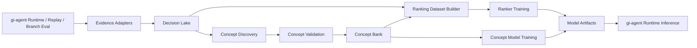

# `gi-ml` Architecture

## 1. Purpose

`gi-ml` 是 `Genius Invokation` 学习子系统的独立架构层。

它的任务不是替代模拟器，而是把以下流程标准化：

- 从 `gi-agent` 产生的证据中构建可训练数据
- 发现概念候选并进行验证
- 将已验证概念组织为可版本化的 `concept bank`
- 基于概念和原始状态特征训练排序器
- 为在线推理导出轻量模型工件和解释信息

## 2. System Boundary

### 2.1 Upstream

上游仍由 `packages/gi-agent` 提供：

- runtime digest
- feedback artifact
- branch-eval report
- combat-window / tree-lake
- self-play / replay 数据

### 2.2 Downstream

下游仍由 `packages/gi-agent` 消费：

- concept bank
- concept predictor
- pairwise / groupwise ranker
- 在线解释元数据

### 2.3 Explicit Non-Goals

- 不重写 `@gi-tcg/core`
- 不把规则正确性下放给 LLM
- 不在第一阶段直接做完全端到端黑盒策略替换

## 3. High-Level Flow

## 4. Core Modules

### 4.1 Evidence Adapters

作用：

- 统一接入 `branch-eval`、`combat-window`、`self-play`、`replay`
- 为不同来源生成稳定的引用 ID
- 把上游异构 JSON 转为统一内部契约

职责边界：

- 只做标准化，不做训练逻辑
- 不在适配层引入评分公式

### 4.2 Decision Lake

作用：

- 作为 `query-group` 级别的数据湖
- 承载决策点、候选动作、pairwise 偏好、证据引用、概念注释

建议特性：

- 以 `query_id` 为核心主键
- 支持跨版本追加、回溯和过滤
- 支持离线训练和验证复用

### 4.3 Concept Discovery

作用：

- 从高价值窗口、误判样本、运转图结构中提出概念候选
- 为概念写入自然语言定义、作用域、证据集合

候选来源：

- LLM 对 combat window 的赛后总结
- 高 regret 决策点聚类
- 套牌图结构分析
- tree library 中可复用局部模式

输出：

- `draft` 状态的 `concept hypothesis`

### 4.4 Concept Validation

作用：

- 判断一个概念是否值得进入线上系统

保留的验证插槽：

- `predictability_slot`
- `stability_slot`
- `transferability_slot`
- `ranking_gain_slot`
- `retrieval_gain_slot`
- `failure_mode_slot`

说明：

- 当前阶段只保留接口，不固定具体公式

### 4.5 Concept Bank

作用：

- 保存已验证概念的版本化集合
- 记录兼容性、废弃规则、验证摘要

必须满足：

- 可版本化
- 可回滚
- 可标记废弃
- 可被在线推理直接消费

### 4.6 Ranking Dataset Builder

作用：

- 将同一决策点下的候选动作组织成组
- 构造 pairwise 或 groupwise 排序样本
- 将概念标签或概念预测值接入样本

说明：

- 第一阶段不要求唯一训练格式
- 但必须保证 `query_id`、`candidate_id`、`preference evidence` 一致

### 4.7 Trainers

建议拆成两类训练器：

- `concept trainer`
- `ranker trainer`

训练目标与指标先预留插槽，不在本文档中写死。

### 4.8 Runtime Export Bridge

作用：

- 将训练结果转换为在线可消费的工件格式
- 为 `gi-agent` 提供轻量推理输入输出契约

推荐工件：

- `concept-bank.json`
- `concept-model.*`
- `ranker-model.*`
- `compatibility.json`

## 5. Runtime Integration

在线推理建议保留两阶段：

1. 用现有规则系统、召回系统和搜索系统生成候选动作与候选树
2. 用 `gi-ml` 导出的概念与排序器做 rerank 和解释

这样可以保持以下性质：

- 规则正确性继续由模拟器保证
- 学习层只影响优先级，不接管合法性
- 出错时可以退回启发式 / baseline policy

## 6. Package Split Recommendation

长期建议将学习栈与 TS runtime 分开：

- `packages/gi-agent`
  - 在线系统
  - 证据采集
  - 搜索与动作执行
- `packages/gi-ml`
  - 学习系统
  - 文档、schema、契约
  - 后续可接入 Python 子工作区

推荐技术路线：

- 训练与实验：Python
- 在线消费与集成：TypeScript

## 7. Interfaces To Be Added In Existing Framework

`gi-agent` 后续需要暴露更多稳定接口：

- 决策点稳定 ID
- 候选动作稳定签名
- branch-eval 组内偏好导出
- combat-window 到 concept hypothesis 的桥接
- tree 命中证据的标准化引用

## 8. Open Slots

本文档暂不固定以下内容：

- 概念发现的具体聚类 / 归纳算法
- 概念验证公式
- 训练损失函数
- 排序评估指标
- 线上 rerank 分解公式

这些内容应在后续实验文档中补充，而不是先写死在架构层。

补充候选方向：

- 关于“将静态卡牌 / 技能效果编译为跨牌共享 meta priors”的方案，见 [static-effect-meta-priors.md](<repo-root>/packages/gi-ml/docs/static-effect-meta-priors.md)。
